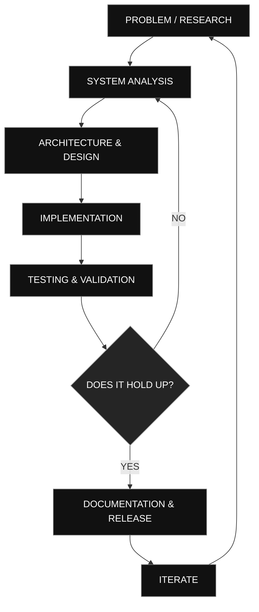

<div align="center">

```text
     ██████╗ ██╗   ██╗███████╗████████╗██╗███╗   ██╗
    ██╔═══██╗██║   ██║██╔════╝╚══██╔══╝██║████╗  ██║
    ██║   ██║██║   ██║███████╗   ██║   ██║██╔██╗ ██║
    ██║▄▄ ██║██║   ██║╚════██║   ██║   ██║██║╚██╗██║
    ╚██████╔╝╚██████╔╝███████║   ██║   ██║██║ ╚████║
     ╚══▀▀═╝  ╚═════╝ ╚══════╝   ╚═╝   ╚═╝╚═╝  ╚═══╝

              S K A N D E R   W A L I
```

<h3>CYBERSECURITY · SYSTEMS ENGINEERING · SOFTWARE DEVELOPMENT</h3>

<sub>BUILDING TOOLS · UNDERSTANDING SYSTEMS · BREAKING ASSUMPTIONS</sub>

<br/>

<a href="https://github.com/dustin04x">

</a>
<a href="https://github.com/dustin04x?tab=repositories">

</a>
<a href="mailto:skanderwali@protonmail.com">

</a>

</div>

---

```text
┌──────────────────────────────────────────────────────────────────┐
│                                                                  │
│   USER       : SKANDER WALI                                      │
│   HANDLE     : dustin04x                                         │
│   ROLE       : CYBERSECURITY ENTHUSIAST / SYSTEMS DEVELOPER      │
│   ENVIRONMENT: LINUX / LOW-LEVEL / SECURITY / SOFTWARE           │
│   MODE       : BUILDING                                          │
│                                                                  │
│   ────────────────────────────────────────────────────────────   │
│                                                                  │
│   MINDSET    : UNDERSTAND > IMPLEMENT > BREAK > IMPROVE          │
│                                                                  │
└──────────────────────────────────────────────────────────────────┘
```

## `01` — THE OPERATOR

I'm Skander, a computer science student and developer fascinated by the intersection of cybersecurity, systems engineering, and software development.

I enjoy understanding what happens beneath abstractions — from network protocols and operating system internals to memory, execution, and application security.

I don't just want to use existing tools. I want to understand their internals, challenge their assumptions, and build my own.

**My engineering interests:**

- Offensive security, exploitation and reverse engineering.
- Systems programming and operating system internals.
- Network protocols, traffic inspection and analysis.
- Security automation and developer tooling.
- Secure backend architecture and application development.
- Low-level programming, performance and architecture.

---

## `02` — TECHNICAL STACK

<div align="center">

**LANGUAGES**


**DEVELOPMENT**


**DATABASES & INFRASTRUCTURE**


</div>

<details>
<summary><b>Detailed technical interests</b></summary>

| Domain | Technologies / Areas |
|---|---|
| Systems | Rust, C, C++, Linux, eBPF |
| Programming | Python, Java, JavaScript, TypeScript |
| Security | Binary Exploitation, Web Security, Reverse Engineering |
| Networking | TCP/IP, HTTP, Traffic Analysis, Wireshark |
| Backend | Node.js, Express, JWT, REST APIs |
| Frontend | React, HTML, CSS |
| Databases | PostgreSQL, MySQL, MongoDB, SQLite |
| Infrastructure | Docker, Linux, Bash, Git |

</details>

---

## `03` — SELECTED ENGINEERING

Not just repositories. Experiments, engineering challenges, and tools built to understand systems better.

<table>
<tr>
<td width="50%" valign="top">

<h3>01 / RAWFRAME</h3>


A systems-oriented HTTP proxy and repeater focused on traffic interception, inspection, manipulation, and replay.

**Engineering highlights**

- Interactive terminal interface.
- HTTP proxy architecture.
- TLS interception.
- Request/response storage.
- Functional HTTP repeater.
- Decoder pipeline.

<a href="https://github.com/dustin04x/RAWFRAME"><b>→ EXPLORE REPOSITORY</b></a>

</td>
<td width="50%" valign="top">

<h3>02 / ELVYN</h3>


A DevSecOps security scanning platform designed to bring security analysis into a unified workflow.

**Engineering highlights**

- Static analysis with Semgrep.
- Secret detection with Gitleaks.
- Container scanning with Trivy.
- PostgreSQL persistence.
- JWT authentication.
- Argon2id password hashing.

<a href="https://github.com/dustin04x/ELVYN"><b>→ EXPLORE REPOSITORY</b></a>

</td>
</tr>
<tr>
<td width="50%" valign="top">

<h3>03 / SYSCALL</h3>


A Linux systems observability experiment exploring kernel-level event collection and processing.

**Engineering highlights**

- eBPF scheduler tracepoints.
- Rust event decoder.
- SQLite persistence.
- Kernel event instrumentation.
- Systems-level experimentation.

</td>
<td width="50%" valign="top">

<h3>04 / FLOWSTATE</h3>


A desktop productivity application built around focused work sessions and customizable workflows.

**Engineering highlights**

- Electron desktop architecture.
- React and TypeScript.
- Timer functionality.
- Custom presets.
- System tray integration.

<a href="https://github.com/dustin04x/FlowState"><b>→ EXPLORE REPOSITORY</b></a>

</td>
</tr>
</table>

---

## `04` — SECURITY RESEARCH

```text
                         ATTACK SURFACE
                               │
             ┌─────────────────┼─────────────────┐
             │                 │                 │
          NETWORK            BINARY              WEB
          SECURITY          ANALYSIS           SECURITY
             │                 │                 │
       ┌─────┴─────┐     ┌─────┴─────┐     ┌─────┴─────┐
       │           │     │           │     │           │
    PACKETS    PROTOCOLS MEMORY    REVERSE  API       AUTH
       │           │     │           │     │           │
       └─────┬─────┘     └─────┬─────┘     └─────┬─────┘
             │                 │                 │
             └─────────────────┼─────────────────┘
                               │
                      SYSTEMS SECURITY
                               │
                    UNDERSTAND THE MACHINE
```

**Areas of exploration**

- Binary exploitation
- Reverse engineering
- Web application security
- Network security
- Digital forensics
- Cryptography
- Linux internals
- Secure coding
- CTF research and challenge development

---

## `05` — ENGINEERING BLUEPRINT

How I think about building software:



I value understanding, reproducibility, maintainability, and engineering decisions that can be explained.

---

## `06` — CURRENT TRAJECTORY

```bash
┌──(dustin04x㉿localhost)-[~]
└─$ cat /etc/engineering.conf

FOCUS="Systems Engineering"
RESEARCH="Offensive Security"
LANGUAGE="Rust / C / Python"
ENVIRONMENT="Linux"
OBJECTIVE="Build meaningful security software"

└─$ ./next_milestone.sh

[+] Deepening systems programming knowledge
[+] Exploring exploitation techniques
[+] Developing practical security tools
[+] Improving security engineering workflows

STATUS: IN PROGRESS
```

---

## `07` — GITHUB TELEMETRY

<div align="center">

<a href="https://github.com/dustin04x">

</a>
<a href="https://github.com/dustin04x">

</a>

<br/>

<a href="https://github.com/dustin04x">

</a>

<br/>

<a href="https://github.com/dustin04x">

</a>

</div>

---

## `08` — ESTABLISH CONNECTION

<div align="center">

```text
       ┌──────────────────────────────────────┐
       │                                      │
       │            OPEN CHANNEL              │
       │                                      │
       │    Collaboration / Security / Dev    │
       │                                      │
       │         CONNECTION AVAILABLE        │
       │                                      │
       └──────────────────────────────────────┘
```

<a href="https://linkedin.com/in/skander-wali-901040391">

</a>
<a href="https://instagram.com/skanderwali">

</a>
<a href="mailto:skanderwali@protonmail.com">

</a>
<a href="https://github.com/dustin04x">

</a>

<br/><br/>

**UNDERSTAND THE SYSTEM. QUESTION THE ABSTRACTION. BUILD SOMETHING BETTER.**

<sub>SKANDER WALI · DUSTIN04X · 2026</sub>

<sub>ENGINEERED WITH CURIOSITY.</sub>

</div>
