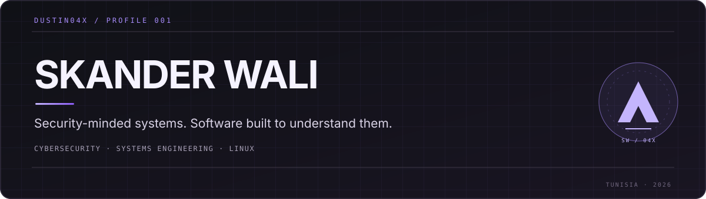

 <div align="center">
  
</div>

<div align="center">

[GitHub](https://github.com/dustin04x) · [Portfolio](https://github.com/dustin04x/skander-wali-portfolio) · [LinkedIn](https://linkedin.com/in/skander-wali-901040391) · [Email](mailto:skanderwali@protonmail.com)

</div>

---

## 01 / PROFILE

```text
IDENTITY     Skander Wali
HANDLE       dustin04x
LOCATION     Tunisia
EDUCATION    Computer Science · ISITCom

DISCIPLINES  Cybersecurity / Systems Engineering
BUILD        Security tools, systems software, developer tooling
STUDY        Linux internals, network protocols, application security
EXPLORE      eBPF, reverse engineering, binary exploitation
```

I'm a Computer Science student interested in understanding software beyond its interfaces.

My work revolves around cybersecurity, systems programming, and software engineering. I enjoy investigating how systems behave, understanding their boundaries, and building tools that make them easier to inspect, test, and understand.

I learn by building: researching a problem, implementing a solution, testing its behavior, and documenting the engineering behind it.

My main interests are **security research, low-level software engineering, and Linux systems**.

---

## 02 / SELECTED WORK

A selection of projects exploring security, systems, and practical engineering.

<table>
<tr>
<td width="50%" valign="top">

### 01 — RAWFRAME

**HTTP INTERCEPTION & SECURITY TESTING**

[Repository ↗](https://github.com/dustin04x/RAWFR4ME)  
[Documentation ↗](https://rawframe.mintlify.site)

A terminal-native HTTP interception and security testing workbench written in Rust.

- Local forward proxy
- Opt-in TLS interception
- HTTP/1.1, HTTP/2 and WebSockets
- SQLite request history
- Repeater and request analysis workflows

`RUST` `HTTP` `TLS` `SQLITE`

</td>
<td width="50%" valign="top">

### 02 — SYSCALL

**LINUX RUNTIME FORENSICS**

[Repository ↗](https://github.com/dustin04x/syscall)  
[Documentation ↗](https://syscall.mintlify.site)

A Linux runtime forensics system built around real kernel telemetry.

- eBPF event collection
- Process lifecycle monitoring
- File-open and network-connect events
- Rust event decoder
- SQLite evidence persistence
- CLI and read-only desktop workbench

`RUST` `eBPF` `LINUX`

</td>
</tr>
<tr>
<td width="50%" valign="top">

### 03 — ROOTLAB

**OFFENSIVE SECURITY SIMULATION**

[Repository ↗](https://github.com/dustin04x/RootLab)  
[Live Demo ↗](https://dustin04x.github.io/RootLab/)

A browser-based cybersecurity learning platform built around simulated terminal workflows and mission-driven security scenarios.

- Simulated shell environment
- Mission-based progression
- Modular scenarios
- Safe, deterministic execution

</td>
<td width="50%" valign="top">

### 04 — SECTOOLS

**PORTABLE SECURITY TOOLKIT**

[Repository ↗](https://github.com/dustin04x/Sectools)

A browser-based toolkit combining practical offensive and defensive security utilities.

- Port scanning and service mapping
- Cryptography and JWT inspection
- IP intelligence and DNS lookup
- HTTP security analysis
- IOC extraction

`NEXT.JS` `TYPESCRIPT` `FASTAPI` `PYTHON`

</td>
</tr>
<tr>
<td width="50%" valign="top">

### 05 — THREATCANVAS

**VISUAL MALWARE ATTACK SIMULATION**

[Repository ↗](https://github.com/dustin04x/ThreatCanvas)  
[Live Demo ↗](https://dustin04x.github.io/ThreatCanvas/)

An interactive cybersecurity education platform for understanding threats, analyzing attacks, and exploring defensive strategies.

`REACT` `TYPESCRIPT` `VITE`

</td>
<td width="50%" valign="top">

### 06 — METASCAN

**IMAGE FORENSICS**

[Repository ↗](https://github.com/dustin04x/Metascan)  
[Live Demo ↗](https://dustin04x.github.io/Metascan/)

A client-side image metadata extraction and analysis tool designed for privacy-conscious investigation and CTF workflows.

- EXIF and GPS extraction
- Binary and entropy analysis
- String extraction
- File signature inspection
- Steganography indicators

</td>
</tr>
</table>

### Other projects

| Project | Description |
|:--|:--|
| [FlowState](https://github.com/dustin04x/FlowState) | Local-first desktop focus timer built with Electron and React. |
| [PortScanner](https://github.com/dustin04x/portscanner) | Port scanning utility. |
| [Cryptography Helper](https://github.com/dustin04x/Cryptography-helper) | Cryptography utility. |
| [RSA Key Generator](https://github.com/dustin04x/rsa-key-generator) | RSA key generation utility. |

---

## 03 / TECHNICAL STACK

**LANGUAGES**

`Rust` `C` `C++` `Python` `JavaScript` `TypeScript` `Java` `Bash`

**SYSTEMS & INFRASTRUCTURE**

`Linux` `eBPF` `Docker` `Git` `SQLite` `PostgreSQL`

**APPLICATION DEVELOPMENT**

`Node.js` `Express` `FastAPI` `React` `Electron` `Tauri`

**SECURITY & RESEARCH**

`Network Analysis` · `Web Security` · `Digital Forensics`

`Reverse Engineering` · `Binary Exploitation` · `Cryptography`

`Security Automation` · `Linux Internals` · `CTF`

---

## 04 / CURRENT INTERESTS

```text
[01]  Kernel-level observability and eBPF
[02]  Reverse engineering and binary exploitation
[03]  Network protocol analysis and HTTP security
[04]  Security engineering and developer tooling
[05]  Linux internals and low-level programming
```

---

## 05 / BEYOND THE TERMINAL

Outside software engineering, I spend time exploring music production, sound design, and creative workflows.

I enjoy the same process in both worlds: experimentation, iteration, and building something from an idea.

---

## 06 / CONTACT

Interested in cybersecurity, systems engineering, open-source collaboration, or PFE internship opportunities?

**Let's build something worth understanding.**

<div align="center">

[EMAIL](mailto:skanderwali@protonmail.com) · [LINKEDIN](https://linkedin.com/in/skander-wali-901040391) · [GITHUB](https://github.com/dustin04x)

<br>

<sub>SKANDER WALI / DUSTIN04X / 2026</sub>

</div>
